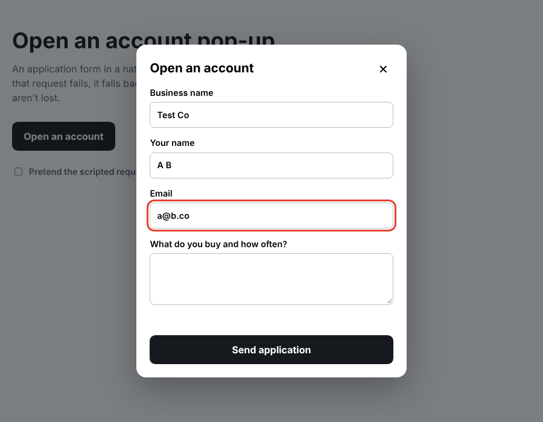

# Account pop-up with a fallback

A sign-up form in a native `<dialog>` that sends without reloading the page, and quietly falls back to a normal form submit if that request fails.

I ran into this on a wholesale storefront: the pop-up form threw an error for some visitors, and the person lost their answers. The fix was to make the plain HTML form the real thing, and treat the scripted version as an upgrade. This repo is a stand-alone version with no client content.



## Run it

No build step. Open `index.html`, click the button, and fill in the form.

Tick **Pretend the scripted request fails** first to see the fallback. After a moment the browser submits the form normally and lands on `thanks.html`.

## How it works

- The `<form>` has a real `action` and `method`, so it works on its own.
- The script intercepts `submit`, sends the data in the background, and shows a status message.
- If that request fails, the script calls `form.submit()`. That skips the script's own handler, so it can't loop, and the browser does a regular post.

## Things I paid attention to

- **Native `<dialog>`:** the browser handles focus, the Escape key and the backdrop.
- **Labels and autocomplete:** every field has a visible label and the right `autocomplete` value, so phones can fill it in.
- **Status messages:** the status line is a live region, so screen readers hear "Sending..." and the result.
- **The submit button is disabled while sending**, so it can't be pressed twice.

## Using it for real

1. Point `action` at your form handler (on Shopify, a contact form works).
2. Replace `fakeSend` with a `fetch()` to the same URL and throw if the response isn't OK.
3. Keep the fallback. It is the part that saves submissions.

## Files

```
index.html    page and the dialog
thanks.html   where the plain submit lands in the demo
styles.css    page, dialog and form styles
script.js     open / close, background send and the fallback
```

## License

MIT. See the `LICENSE` file at the top of this repo.
