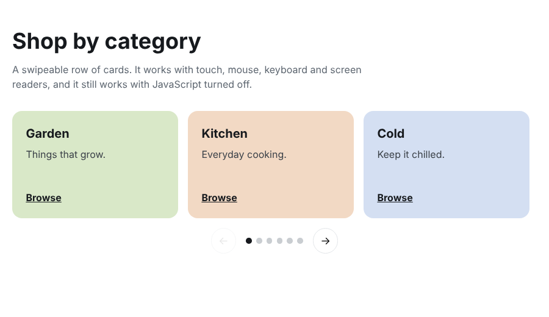

# Category carousel

A row of category cards you can swipe, click through or move with the arrow keys. Plain HTML, CSS and a short script.

I built a version of this for the category section of a wholesale storefront. This repo is a stand-alone rebuild with sample content. None of the client's content is in it.



## Run it

No build step. Open `index.html` in a browser.

## How it works

- The cards sit in a flex row with `overflow-x: auto` and `scroll-snap-type: x mandatory`, so the browser handles swiping and snapping. That means touch scrolling works with no JavaScript.
- The script adds the previous / next buttons and the dots. It reads the scroll position to work out which card is current, and calls `scrollTo` to move.
- The buttons are disabled at each end.

## Things I paid attention to

- **Keyboard:** the track can take focus and moves with the left and right arrow keys. All buttons are real buttons with labels.
- **Screen readers:** the section is labelled as a carousel and every dot says which category it goes to.
- **Reduced motion:** smooth scrolling is only turned on if the visitor hasn't asked for less motion.
- **Phones:** the cards are 78% wide on small screens, so the next card peeks in and shows that there is more.

## Make it yours

Add or remove `<li class="slide">` items in `index.html`. Change the card colour with the `--c` variable on each one. You don't need to touch the script.

## Files

```
index.html   markup and sample cards
styles.css   layout, snapping and controls
script.js    buttons, dots and keyboard support
```

## License

MIT. See the `LICENSE` file at the top of this repo.
