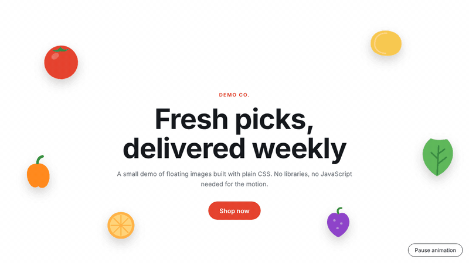

# Floating hero, CSS only

A small hero section where product-style images float gently behind a headline. The motion is plain CSS. There are no libraries and no animation frameworks.

I built this as a stand-alone demo of a technique I used on a responsive wholesale storefront. The client's code and images are not included here.



## Run it

No build step. Download the folder and open `index.html` in a browser.

## How it works

- Each floating image is a list item positioned with `left` and `top` from CSS variables (`--x`, `--y`).
- One `@keyframes float` rule moves every item up and down and tilts it slightly.
- Each item has its own size, duration, delay and drift set inline, so they don't move in sync. Negative delays make the page look mid-motion on load.
- The text sits above the images with `position: relative` and `z-index`.
- The small script only toggles a class so people can pause the motion.

## Things I paid attention to

- **Reduced motion:** if the visitor's system asks for less motion, the animation is turned off.
- **Phones:** on narrow screens the images shrink and two are hidden so the text stays readable.
- **Performance:** the animation only changes `transform`, which browsers handle smoothly.
- **Accessibility:** the decorative images have empty `alt` text and are hidden from screen readers. The pause button is keyboard-focusable.

## Make it yours

Open `index.html` and edit the inline values on each `<li>`:

| Variable | What it does |
| --- | --- |
| `--x`, `--y` | position in the hero |
| `--size` | image width |
| `--time` | one float cycle (a few seconds looks natural) |
| `--delay` | start offset, negative values start mid-cycle |
| `--drift` | how far it moves up and down |

Swap the files in `assets/` for your own images.

## Files

```
index.html   markup and the floating items
styles.css   layout, animation and responsive rules
script.js    pause button
assets/      the SVG images and the preview GIF
```

## License

MIT. See the `LICENSE` file at the top of this repo.
