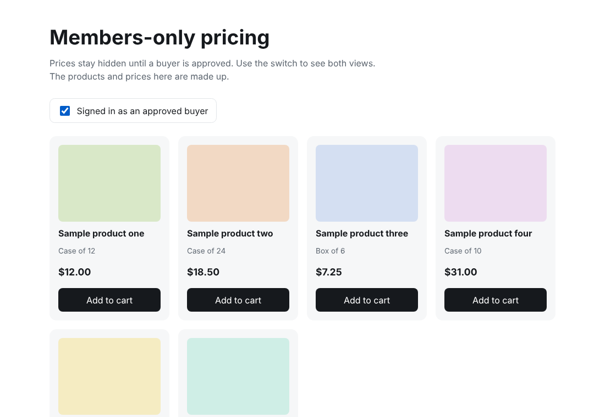

# Members-only pricing

Hide prices until a buyer has been approved, then show them. This is a small demo of the idea plus the Liquid snippet you would use in a Shopify theme.

I built this pattern for a wholesale storefront where prices couldn't be public. The client's catalog, prices and branding are not included. Everything here is made-up sample data.



## Run the demo

No build step. Open `index.html` in a browser and flip the switch at the top.

## How it works

1. A customer signs up. Nothing about pricing is visible to them yet.
2. The store owner reviews the account and adds a tag, `approved`, to the customer in Shopify.
3. `liquid/price-gate.liquid` checks `customer.tags` and either prints the price or a "Members only" label.

The price is never in the HTML for logged-out visitors. It isn't just hidden with CSS, because anyone could read it in the page source.

## Using it in a theme

1. Copy `liquid/price-gate.liquid` into your theme's `snippets/` folder.
2. Where the price is printed, replace it with ``.
3. Copy the `.lock` and `.price-slot` rules from `styles.css` into your theme's CSS.
4. Tag approved customers with `approved`, or change `approved_tag` in the snippet.

Prices can also show up in other places: cart, search suggestions, structured data and apps. Check each one. This snippet only covers the product card.

## Details I cared about

- The price slot has a fixed minimum height, so the grid doesn't jump when the state changes.
- The locked state is a real disabled button, not a styled link that looks disabled.
- The lock icon has no meaning on its own, so the text "Members only" carries the message.

## Files

```
index.html             demo page
styles.css             demo styles
script.js              fake catalog and the approved / not approved switch
liquid/price-gate.liquid   the Shopify snippet
```

## License

MIT. See the `LICENSE` file at the top of this repo.
