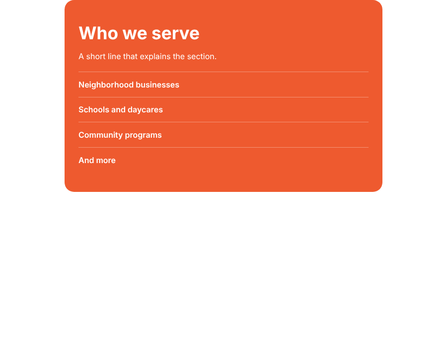

# Scroll reveal text

A section whose lines fade in one after another when it scrolls into view. About 15 lines of JavaScript, no libraries.

This comes from the "Who we serve" section of a wholesale storefront I built. The client's wording is not included. The text here is sample copy.



## Run it

No build step. Open `index.html` and scroll down.

## How it works

- Every element with the class `reveal` starts slightly lower and invisible.
- An `IntersectionObserver` watches the whole panel. When about a third of it is on screen, it adds `is-in` to each item.
- Each item gets an index in a CSS variable (`--i`), and `transition-delay` multiplies it, so the lines appear in sequence.
- The observer disconnects after it fires, so it only plays once.

## Things I paid attention to

- **No JavaScript:** the hidden start state only exists once the script has added a `js` class. If scripts are blocked, the text just shows.
- **Reduced motion:** visitors who ask for less motion get the text immediately, with no movement.
- **Old browsers:** if `IntersectionObserver` isn't available, everything is shown at once.
- **Only opacity and transform change**, which keeps the animation smooth.

## Tweaks

| What | Where |
| --- | --- |
| Speed of each line | `transition` in `styles.css` |
| Gap between lines | `110ms` in the `transition-delay` rule |
| When it starts | `threshold` in `script.js` |

## Files

```
index.html   sample section
styles.css   start state, transition and reduced-motion rule
script.js    the observer
```

## License

MIT. See the `LICENSE` file at the top of this repo.
